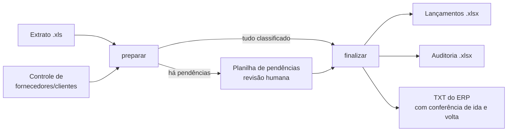

# Classificação de extrato bancário por regras de negócio

Lê o extrato mensal do banco (`.xls`), classifica cada movimentação em **conta débito e conta crédito** e gera a planilha contábil final e o TXT de importação do ERP. O que não dá para classificar com segurança vira **pendência para revisão humana**, e nada é finalizado enquanto houver pendência.

## Fluxo em duas etapas



```bash
python main.py preparar  --extrato input/extrato.xls
# (preencher output/pendencias_<empresa>_AAAA_MM.xlsx, se houver)
python main.py finalizar --extrato input/extrato.xls
```

## Regras de classificação (ordem de precedência)

| # | Regra | Exemplo | Resultado |
|---|---|---|---|
| 1 | Transferência entre contas da empresa | `TRANSFERENCIA ... - PR` | conta fixa de transferência |
| 2 | Pró-labore (**vence** a regra de salário) | `... SALARIOS- EMPRESA - PRO LABORE SOCIO B` | conta de pró-labore |
| 3 | Salário, pela data (±3 dias do dia 6 ou do dia 20) | pago em 05/08 | conta de salário do dia 6 |
| 4 | `Pago:` → fornecedor no Controle | `Pago: 123 - DISTRIBUIDORA ALFA` | débito = conta do fornecedor |
| 5 | `Recebido:` → cliente no Controle | `Recebido: 456 - CLIENTE GAMA` | crédito = conta do cliente |
| 6 | Busca direta no Controle | `IOF`, `TARIFA ...` | contas do cadastro |
| 7 | Nada se aplica | fornecedor novo | **pendência** |

Detalhes que evitam erro silencioso:

- **O nome mais longo vence.** `BANCO SANTANDER - CONSORCIO` tem prioridade sobre `BANCO SANTANDER`.
- **Empate com contas diferentes vira `AMBIGUO`.** Empate que leva às mesmas contas é só cadastro duplicado.
- **`PREENCHER MANUAL`** no cadastro nunca vira lançamento automático.
- **Salário fora da janela de ±3 dias vira pendência.** Nenhuma tolerância além da confirmada é presumida.
- **Aliases** (grafia do banco diferente do cadastro) ficam explícitos na configuração, nunca escondidos no matching.

## Rodando com o mês fictício

```bash
pip install -r requirements.txt
python main.py preparar  --extrato dados_exemplo/extrato_2026_08.xls \
                         --controle dados_exemplo/controle_fornecedores_clientes.xlsx
```

O resultado são 24 movimentos: 21 classificados automaticamente e 3 pendências, uma de cada tipo (salário fora da janela, cadastro `PREENCHER MANUAL` e fornecedor sem cadastro). [`gerar_dados_exemplo.py`](gerar_dados_exemplo.py) recria o mês e simula a revisão humana. A versão preenchida da planilha de pendências está em `dados_exemplo/`.

Passo a passo de uso mensal: [`COMO_RODAR.md`](COMO_RODAR.md).

## Dados do cliente fora do código

[`config/configuracoes.py`](config/configuracoes.py) concentra todas as regras confirmadas: contas, âncoras de salário, layout do TXT. Ele vem com os valores de uma **empresa fictícia**. Os valores reais do cliente ficam em `config/configuracoes_locais.py`, que é ignorado pelo Git (modelo em [`configuracoes_locais.example.py`](config/configuracoes_locais.example.py)).

## Testes

```bash
pytest          # 37 testes
```

Cobrem cada regra do classificador, incluindo as bordas da janela de salário, e o fluxo completo: leitura do `.xls` e conferência de saldo, bloqueio com pendências, finalização e o ajuste manual chegando ao lançamento final.
