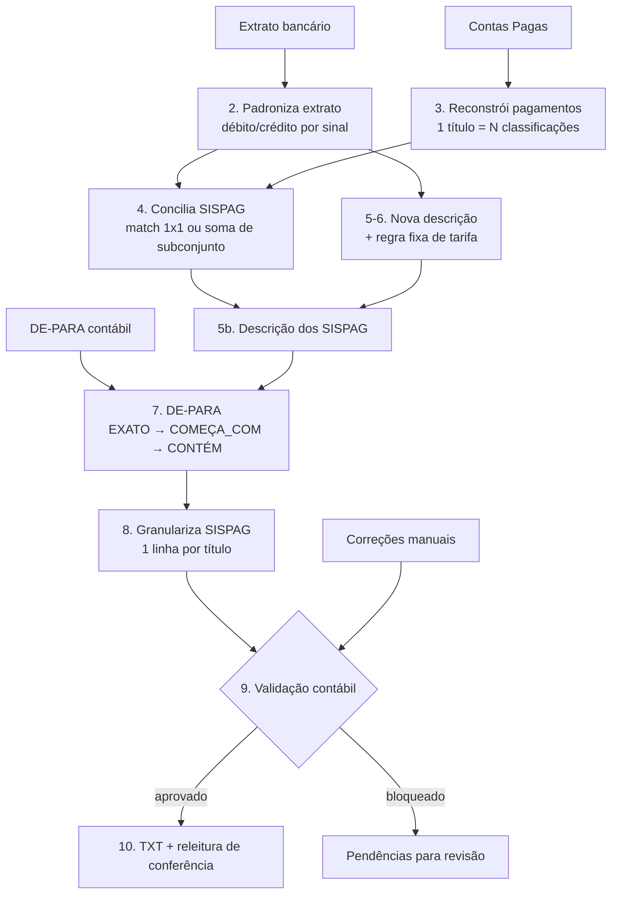

# Conciliação bancária → TXT de importação contábil

Pipeline mensal que cruza o **extrato bancário** com o **relatório de Contas Pagas** do sistema de gestão do cliente, classifica cada movimentação numa conta contábil e gera o **TXT de importação do ERP**. O TXT só é gerado se todas as linhas passarem na validação.

## O problema

No extrato, dezenas de pagamentos a fornecedores aparecem como um único débito, `SISPAG FORNECEDORES`. Para contabilizar certo, é preciso descobrir **quais títulos do Contas Pagas compõem cada débito** e lançar um por um, cada um na conta do seu fornecedor. À mão, isso significa somar combinações de valores até bater.

## Como funciona



Cada fase grava a própria auditoria em Excel (`saida/AAAA-MM/auditorias/`). Se uma fase falha, as seguintes não rodam, e o motivo fica no log.

## Destaques técnicos

- **Conciliação por soma de subconjuntos.** Primeiro tenta o match exato 1×1. Se não houver, busca a combinação de pagamentos que soma o valor do débito, usando centavos inteiros e poda por soma de sufixo. Se existirem **duas** combinações possíveis, o caso vira `AMBIGUO` e não é escolhido no chute.
- **Um pagamento nunca é usado duas vezes.** O conjunto de candidatos é consumido a cada match, e a granularização confere isso de novo, de forma independente.
- **DE-PARA com prioridade e especificidade.** `EXATO` vence `COMEÇA_COM`, que vence `CONTÉM`. Duas regras empatadas apontando contas diferentes resultam em `AMBIGUO`. Regras redundantes que levam à mesma conta não são tratadas como conflito.
- **Correções manuais numa camada separada.** A saída contábil nunca é editada à mão. As correções ficam num arquivo próprio, rastreável, aplicado antes da validação.
- **Zero à esquerda preservado de ponta a ponta.** Esse bug apareceu três vezes (o pandas lendo `00248` como `248.0`), e hoje há testes de regressão contra ele.
- **Layout do ERP obtido por engenharia reversa** de um TXT real e documentado em [`docs/especificacao_layout_txt.md`](docs/especificacao_layout_txt.md).

## Rodando com o mês fictício

```bash
pip install -r requirements.txt
python main.py dados_exemplo/extrato_banco_2026_08.xlsx \
               dados_exemplo/contas_pagas_2026_08.xlsx \
               dados_exemplo/de_para_contabil.xlsx \
               dados_exemplo/correcoes_manuais.xlsx
```

```
STATUS:      TXT_GERADO_VALIDADO
COMPETÊNCIA: 2026-08
  movimentacoes_bancarias: 58
  sispag: {'EXATO_1X1': 5, 'EXATO_SOMA': 5, 'AMBIGUO': 0, 'NAO_ENCONTRADO': 0}
  linhas_contabeis: 64 | linhas_aprovadas: 64 | linhas_bloqueadas: 0
```

O mês de exemplo é gerado por [`gerar_dados_exemplo.py`](gerar_dados_exemplo.py). Ele cobre todos os caminhos do código: tarifas, SISPAG com 1, 2 e 3 pagamentos, fornecedor repetido no mesmo débito, título com duas classificações, divergência entre valor e classificação, pagamentos de outra conta e um fornecedor sem regra, que é resolvido por correção manual. O script repete a rotina real: roda uma vez, lê as pendências, grava as correções e roda de novo.

Passo a passo de uso mensal: [`COMO_RODAR.md`](COMO_RODAR.md).

## Configuração

A conta bancária do cliente não fica no código. Defina a variável `CONCILIACAO_CONTA_ALVO` (veja [`.env.example`](.env.example)). Sem ela, vale o valor usado nos dados de exemplo.

## Testes

```bash
pytest          # 207 testes
```

Os testes cobrem cada fase isolada (motor de SISPAG, motor de DE-PARA, validador, exportação) e o pipeline completo sobre o mês fictício. O TXT gerado precisa ser **idêntico byte a byte** ao de referência.
